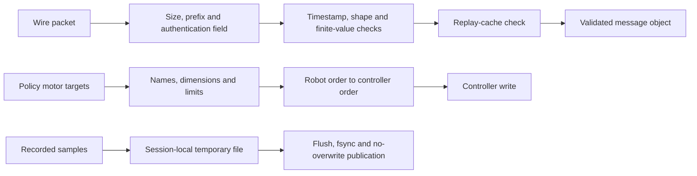

# Contracts between robot messages, motor targets and recordings

Alfred's public contribution is a patch to ToddlerBot plus a reference-geometry exporter. The engineering question here is how to reject malformed or mismatched inputs before they cross a consequential boundary. A network message, a motor-angle vector and a saved episode each need a different contract.

The runtime source and its regression tests are in [`0001-runtime-validation.patch`](patches/0001-runtime-validation.patch). File and function names below identify its diff sections. [`upstream.json`](upstream.json) pins the base and patch checksum. These are modifications to the attributed ToddlerBot platform, not a claim to have authored its robot or trained policies. Tradeoff rationales below are interpretations of the implementation.

## Follow a received message

The `toddlerbot/utils/comm_utils.py` changes replace network pickle decoding with a versioned packet. `encode_message()` normalizes the accepted fields, serializes array shape and bytes, adds a send time and fresh nonce, then constructs a four-byte magic prefix, 32-byte authentication field and JSON payload.

`decode_message()` checks the wire-size limit and prefix, checks the authentication field before interpreting the JSON, checks the envelope fields and validates its timestamp. `_message()` accepts exactly the declared message fields. `_array()` permits one to three dimensions for a camera array, requires one dimension for action and force arrays, checks element counts and requires the decoded byte length to match shape times item size. It converts actions to little-endian float32 and rejects nonfinite values.

`ZMQNode` defaults to loopback. A non-loopback address requires a shared key of at least 32 bytes. With a configured key the authentication field is an HMAC; keyless loopback uses zero signature bytes and does not authenticate local senders. The receiver's `get_msg()` drains at most 64 packets per call, rejects duplicate nonces and caps its replay cache at 8,192 entries. It can return the last valid message from that batch. This is bounded message processing, not a wall-clock execution deadline or a guarantee of receiving the globally newest packet.



The message and motor paths are separate boundaries in this diagram. The patch does not establish that every incoming message travels through a complete, independently supervised command pipeline.

## Follow a target to a controller

In `toddlerbot/sim/real_world.py`, `RealWorld.set_motor_target()` first validates that `motor_ordering` contains each configured motor exactly once. Named targets must have precisely the same key set. The function constructs values in robot order instead of trusting dictionary insertion order.

Array input must have shape `(robot.nu,)` and a numeric dtype. Conversion to float32 occurs before the finite-value check, so a value that overflows that representation cannot reach the write path. The function validates each configured lower/upper limit pair and rejects out-of-range targets. It then applies `motor_unsort_idx`, splits by controller motor counts and forwards the result.

The boundary rejects positions outside configured limits. It does not check velocity, acceleration, command age, contact state or whether torque should be armed. Passing this function is therefore not proof that a movement is safe.

## A worked ordering failure

`test_named_targets_follow_robot_and_controller_order` provides a three-motor example, with all angles in radians:

```text
Robot order:          [shoulder, elbow, wrist]
Incoming dictionary:  {wrist: -1.5, shoulder: 0.5, elbow: 1.5}
Validated robot array:[0.5, 1.5, -1.5]
Controller index map: [2, 0, 1]
Reordered array:      [-1.5, 0.5, 1.5]
Controller lengths:   [1, 2]
Controller payloads:  [[-1.5], [0.5, 1.5]]
```

Using `list(dictionary.values())` would instead begin with `[-1.5, 0.5, 1.5]`. Applying the same controller index map would send `[[1.5], [-1.5, 0.5]]`, assigning valid-looking numbers to the wrong joints. Shape checks alone would not detect that error. The configured identity ordering is the essential invariant.

The same test fixture sets shoulder limits to `[-1, 1]`, elbow to `[0, 2]` and wrist to `[-2, 0]`. A shoulder request of `1.01 rad` raises before the fake controller records any call. The tests also reject missing names, booleans, string arrays, wrong shapes, NaN and invalid limit tables. They exercise the method through a fake controller, not an energized robot.

## Recording is a different kind of boundary

In `toddlerbot/utils/dataset_utils.py`, each `DatasetLogger` gets a UUID session directory. `save()` converts the buffered samples to arrays and writes an LZ4-compressed temporary file in that directory. It flushes and `fsync`s the file, then uses a hard link to publish the final episode name. An existing final name causes failure instead of replacement. The episode counter advances and memory clears only after successful publication.

`move_files_to_exp_folder()` now copies only completed files from that logger's session. Destination filenames include the session ID, and identical existing copies are accepted while differing copies cause a conflict. This addresses the earlier mechanism of collecting similarly named files from a shared temporary directory.

File synchronization and no-overwrite publication protect completed output under the tested failure cases. The implementation does not synchronize the parent directory, and unsaved samples remain in memory. It is not a claim of crash-proof recording under every filesystem or sudden-power-loss condition.

## Tradeoffs and remaining gaps

**Explicit messages cost serialization overhead but make validation possible.** JSON plus base64 has more overhead than direct Python-object serialization. For example, 256 float32 actions occupy 1,024 raw bytes and 1,368 base64 characters before JSON metadata. The code gains declared field names, lengths and numeric representations instead of deserializing arbitrary Python objects. A binary schema could reduce overhead, but would need equally explicit compatibility and validation rules.

**HMAC authenticates peers without providing confidentiality.** Both ends must use the same new protocol and key. Payloads remain readable on the transport. The 30-second maximum age, with a five-second future-clock allowance, rejects old envelopes but is far too broad to serve as a motor-command deadline. A compromised key holder can still send authenticated bad intent; authentication does not decide which motion is appropriate.

**Failing a complete target avoids ambiguous partial writes.** Rejecting a missing joint means a caller must provide the full vector. An alternative partial-update API would need explicit semantics for retained targets, expiry and ownership. Silently carrying forward unspecified joints would hide those decisions inside the motor interface.

**Session isolation spends storage to retain evidence.** Export copies completed episodes and preserves originals. This costs disk space but prevents an export from consuming the only durable recording. A streaming recorder could reduce the unsaved-memory window; it would also need chunk integrity, ordering and recovery rules absent from the current episode format.

## What the regression evidence means

The patch's `step_policy()` advances the actual policy and MuJoCo simulator while checking finite observations/actions, expected action shape and advancing simulation time. The stand cases run 15 control steps, about 0.3 seconds. A simulator that merely constructs without stepping would fail this check, but 0.3 seconds does not establish long-duration balance. Other tests exercise malformed messages, authenticated loopback exchange, recording conflicts and C++ register-conversion boundaries under sanitizers.

The separate [`export_model.py`](scripts/export_model.py) traverses the URDF parent tree with `link_transforms()`, rejects unresolved parents/cycles and composes link and visual transforms at zero joint angles. It reduces visual geometry and records source hashes. It does not export a collision model or infer a balanced standing pose. [`test_model_export.py`](tests/test_model_export.py) checks that narrower contract.

A proposed next implementation and experiment is a timestamped command contract in a simulation-only fake-controller test. For a 50 Hz loop, propose a 40 ms command expiry and inject delayed, reordered and replayed commands across 10,000 cycles. Require zero controller writes from expired commands, exactly one accepted owner per cycle, and a recorded rejection reason. Measure processing time separately from simulation time. These criteria are not implemented or passed here. Physical arming and an independent stop mechanism remain prerequisites for later hardware work.
